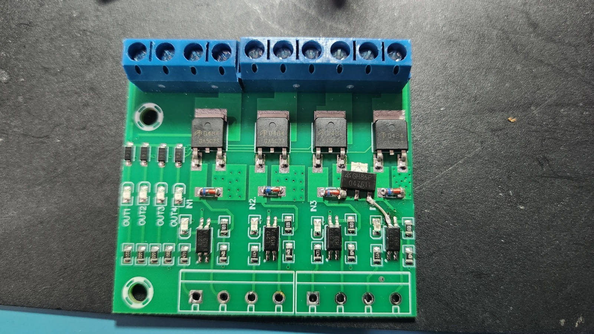
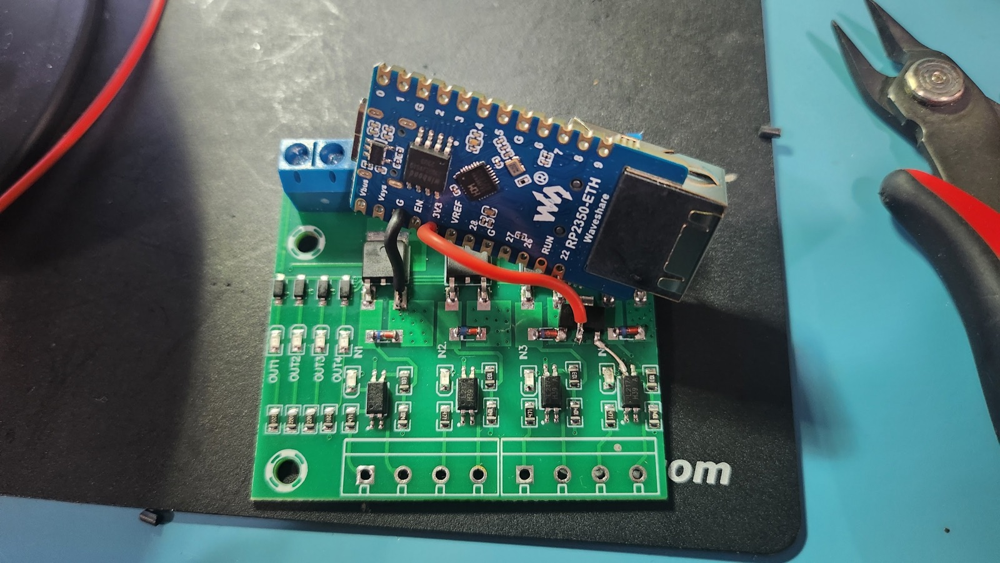
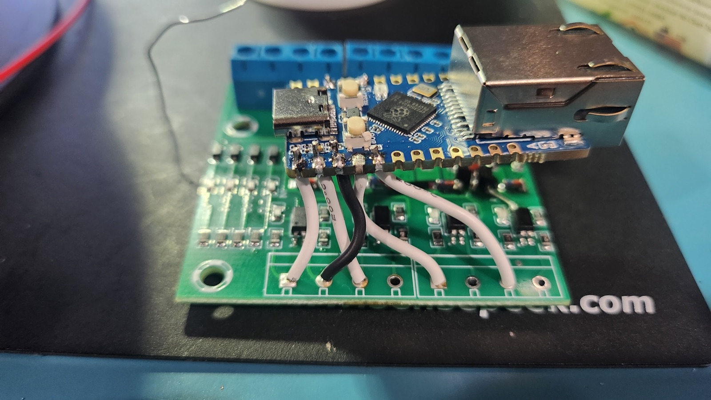
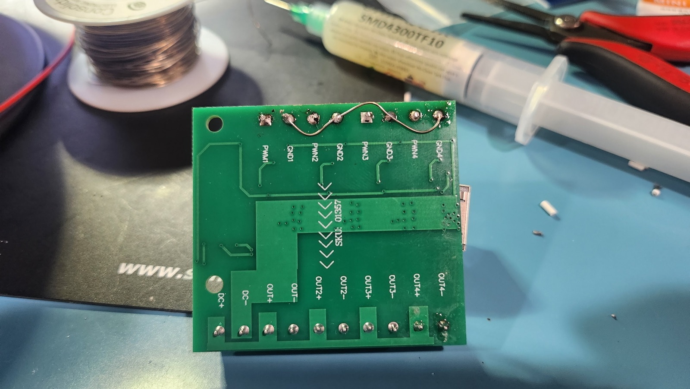

# CalTreat lighting controller

Firmware that turns a **Waveshare RP2350-ETH** into a network-controlled
lighting driver. A host (a Raspberry Pi on the same network) sets pins as
outputs or PWM dimmers and reads inputs over **Modbus TCP**. Here the board
drives a **quad-channel MOSFET module** that switches four 12 V lights.

- **Network:** the board gets an address over DHCP and serves Modbus TCP on
  port 502 to one client at a time. The register map is in
  [`src/regmap.h`](src/regmap.h).
- **Lighting:** PWM dimming with smooth fades runs on the board, plus
  on/off outputs, timed pulses, debounced input edge counting and ADC.
- **Failsafe:** if the host stops talking (heartbeat timeout) or disconnects,
  every pin goes back to its stored default, so the lights turn off by
  default.
- **Updates:** firmware can be updated over Ethernet. The RP2350 boot ROM
  keeps the previous image and rolls back automatically if the new one
  doesn't confirm itself.

Host tools (`lcctl`), the network setup and the tests are covered in
[`tools/README.md`](tools/README.md).

## Hardware

| Part | Notes |
|---|---|
| Waveshare RP2350-ETH | RP2350A + WCH CH9120 Ethernet controller, USB-C for flashing |
| Quad MOSFET module (silkscreen `SKU: 01357`) | 4 opto-isolated low-side channels, PWM1–4 inputs, OUT1–4 ± outputs |
| SOT-223 3.3 V LDO (marked `GH86P`) | added to the module to power the RP2350-ETH from the 12 V supply |
| 12 V supply | into the module's DC+ / DC− terminals; powers the lights and, through the LDO, the RP2350-ETH |

## Wiring

```
        RP2350-ETH                              Quad MOSFET module
   ┌──────────────────┐                  ┌────────────────────────────────┐
   │ GP0 ─────────────┼──── white ──────►│ PWM1                           │
   │ GP1 ─────────────┼──── white ──────►│ PWM2         input header      │
   │ G   ─────────────┼──── black ──────►│ GND1 ═ GND2 ═ GND3 ═ GND4      │
   │ GP2 ─────────────┼──── white ──────►│ PWM3     (bare jumper on back) │
   │ GP3 ─────────────┼──── white ──────►│ PWM4                           │
   │                  │                  │                                │
   │ 3V3 ◄────────────┼──── red ─────────┤ 3.3 V LDO: out   in ◄ DC+      │
   │                  │                  │            GND ◄ MOSFET source │
   │ G   ◄────────────┼──── black ───────┤ module ground (DC−)            │
   │                  │                  │                                │
   │ RJ45 ◄─ Ethernet │     12 V ───────►│ DC+  DC−                       │
   │ USB-C ◄─ flashing│                  │ OUT1± … OUT4± ──► lights 1–4   │
   └──────────────────┘                  └────────────────────────────────┘
```

| RP2350-ETH | Module | Light |
|---|---|---|
| GP0 | PWM1 | OUT1+ / OUT1− |
| GP1 | PWM2 | OUT2+ / OUT2− |
| GP2 | PWM3 | OUT3+ / OUT3− |
| GP3 | PWM4 | OUT4+ / OUT4− |
| G (in the GP0–GP3 header row) | GND1 (GND1–GND4 linked on the back) | |
| 3V3 | 3.3 V LDO output (red) | |
| G (between VSYS and EN) | module ground / DC− (black) | |

Notes:
- **Module inputs:** each PWM input drives an optocoupler, so 3.3 V logic
  switches the 12 V side directly. This only works once each input's
  indicator LED is shorted out (build step 1): it sits in series with the
  optocoupler, and the two together need more than 3.3 V to turn on. Because
  the RP2350-ETH is powered from the same supply, the optocouplers act as
  level shifters here, not as isolation.
- **PWM frequency:** 200 Hz, the firmware default. The optocouplers switch
  slowly, so each pulse stays on a little longer than commanded. At higher
  frequencies that extra time swamps the low duty cycles, and dimming jumps
  to near full brightness. Even at 200 Hz, duty cycles below about 5 % don't
  dim smoothly: the light steps between off and a dim minimum.
- **Regulator heat:** the LDO drops 12 V to 3.3 V, and all of the difference
  turns into heat. At the roughly 100 mA the board draws, that's on the order
  of 1 W (an estimate, not measured), so expect it to run warm and check its
  input rating covers your supply.
- **Flashing over USB:** USB powers the board on its own, so the 12 V supply
  can stay off while you flash.

## Build steps

**1. Short out the input indicator LEDs.** Each channel has a small LED next
to its optocoupler, in series with the optocoupler's input. Their combined
forward voltage is too high for 3.3 V logic, so bridge each of the four LEDs
with solder or a short wire.

**2. Add the 3.3 V regulator to the module.** Solder the SOT-223 LDO onto the
module. Its ground pin goes to one of the MOSFETs' ground (source) pins, and
its input is tapped from DC+ with a short wire to the channel-4 optocoupler
pin.



**3. Power the RP2350-ETH.** Solder a red wire from the LDO output to the
**3V3** pad, and a black wire from the module's ground to the **G** pad next to
VSYS.



**4. Signal wires.** Wire GP0, GP1, GP2 and GP3 (white) to PWM1, PWM2, PWM3
and PWM4 on the module's input header, and the **G** pad in the same row
(black) to GND1.



**5. Link the input grounds.** On the back of the module, run one bare wire
across GND1, GND2, GND3 and GND4, so the single ground wire serves all four
channels.



## Firmware

Built with PlatformIO (the native Pico SDK via the `maxgerhardt` RP2350
platform).

- **Install over USB:** press **Upload** in PlatformIO, or run
  `pio run -t upload`. This works on a blank RP2350 and on a board already
  running this firmware; it writes the partition table and the image. If a
  board doesn't respond, hold BOOT while plugging in USB.
- **Update over Ethernet:** run `uv run lcctl ota` from `tools/` (see
  [`tools/README.md`](tools/README.md)).
- **Version:** set by `custom_fw_version` in [`platformio.ini`](platformio.ini).
  Bump it before an update over Ethernet; the board refuses the version it is
  already running.

The status LED shows the board's state:

| Colour | Meaning |
|---|---|
| White | No client connected |
| Green | Host connected and in control |
| Red | Failsafe: pins at their defaults |
| Yellow | Receiving a firmware update |

**Quick test.** With the board on the network, dim the four lights up from
`tools/`:

```
$ uv run lcctl shell
lcctl> set 0 pwm --freq 200
lcctl> pwm 0 65535 --fade-ms 2000
```

Repeat for pins 1–3, then `quit`. The lights turn off when the shell exits,
because the board puts every pin back to its default when the connection
closes.

## Project layout

```
platformio.ini      build + USB upload settings
partitions.json     flash layout: partition table, app A/B, settings
include/board.h     RP2350-ETH pins and status LED
src/                firmware (main.c, modbus_srv.c + regmap.h, gpio/pwm/adc/events,
                    boot_ctl.c + updater.c for A/B updates, ch9120.c + link.c for Ethernet)
lib/nanomodbus/     Modbus library (MIT, vendored v1.23.0)
scripts/            build_image.py (version + image sealing), upload.py (USB install)
tools/              lcctl host tool and hardware-in-the-loop tests
docs/images/        build photos
```
