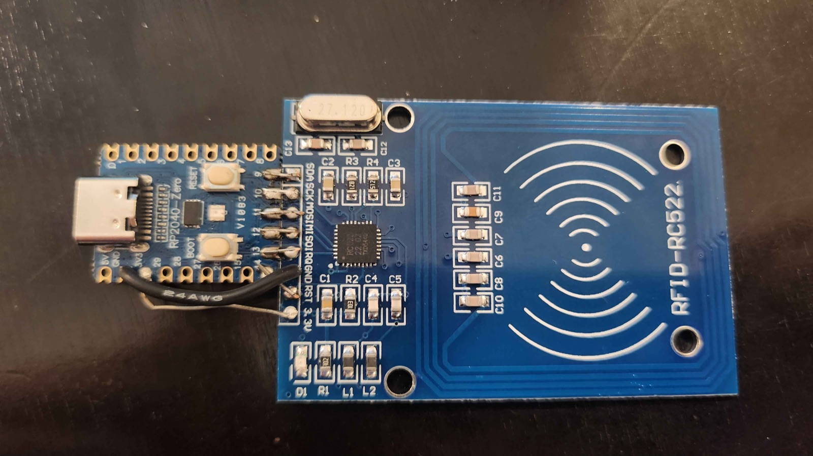

# RC522 → USB NFC bridge (PN532 emulation)

Firmware for a **Waveshare RP2040-Zero** that bridges an **RFID-RC522 (MFRC522)**
module to USB. The RP2040 presents itself as an **NXP PN532 UART reader** over a
USB CDC serial port, so existing NFC software (libnfc, nfcpy,
adafruit-circuitpython-pn532, NFCToolsGUI) can drive it with no custom host stack.

**Scope:** ISO14443A UID detection and **MIFARE Classic 1K/4K** read/write with
host-supplied keys. The RC522 is ISO14443A @ 106 kbps only; other tag families
(DESFire/ISO14443-4, 14443B, FeliCa) are out of scope.

## Status (verified on hardware)

| Capability | Status |
|------------|--------|
| USB enumeration (2× CDC) | ✅ |
| PN532 framing + `GetFirmwareVersion` (reports IC 0x32, v1.6) | ✅ |
| Card detect + UID + SAK (`InListPassiveTarget`) | ✅ |
| Continuous polling | ✅ |
| MIFARE Classic auth (key A and key B) | ✅ |
| MIFARE Classic **read** — full 1K card (all 64 blocks) | ✅ |
| MIFARE Classic **write** | ⚠️ implemented, not yet tested on a card |
| libnfc CLI / NFCToolsGUI | ◻️ not yet exercised end-to-end |

## Wiring (RC522 → RP2040-Zero, SPI1)



The RC522's 8-pin SPI header is, in silkscreen order,
`SDA SCK MOSI MISO IRQ GND RST 3.3V`. Wire it to the RP2040-Zero as:

| RC522 pin | RP2040 GPIO / pin | Function |
|-----------|-------------------|----------|
| SDA/NSS | GPIO 9  | chip select (driven manually) |
| SCK     | GPIO 10 | SPI1 SCK |
| MOSI    | GPIO 11 | SPI1 TX |
| MISO    | GPIO 12 | SPI1 RX |
| IRQ     | GPIO 13 | input (unused; firmware polls) |
| RST     | GPIO 14 | reset (active low) |
| GND     | GND     | ground |
| 3.3V    | 3V3     | power — **3.3 V only, never 5 V** |

Notes on the board pictured above:
- It's a genuine NXP **RC522** (chip marked `RC522`) with the usual **27.12 MHz**
  crystal — standard ISO14443A @ 13.56 MHz / 106 kbps.
- GPIO 10–13 are the RP2040's **SPI1** function pins, so the module sits on the
  `spi1` instance (see [include/pins.h](include/pins.h)).
- In the photo the six SPI/control pins are soldered straight onto the header;
  **GND** and **3.3V** are the two flying leads to the RP2040's `GND`/`3V3` pins.
- The RC522 is powered from the RP2040's 3V3 rail, which is fed from USB 5 V
  through the RP2040-Zero's regulator — the module draws well under the
  regulator's budget, so no external supply is needed.
- `IRQ` (GPIO 13) is wired but unused: the firmware polls, so you can leave this
  pin unconnected if you re-wire. All other pins are required.

## Build & flash

```sh
pio run                          # build
# hold BOOTSEL, plug in the RP2040-Zero, release -> RPI-RP2 drive appears
pio run -t upload                # or copy .pio/build/.../firmware.uf2 to the drive
```

Flashing is via the **BOOTSEL button** (the firmware uses custom USB descriptors,
so the 1200-baud auto-reset is disabled).

## USB ports

The device enumerates **two** CDC serial ports:

- **CDC0 — "RC522 Debug"**: `printf` log (MFRC522 version, per-command trace).
- **CDC1 — "PN532 Emulation"**: the binary PN532 protocol. **Point host tools here.**

On macOS they appear as `/dev/tty.usbmodemXXXX1` and `/dev/tty.usbmodemXXXX3`
(the PN532 port is the higher-numbered one). Confirm with:

```sh
ls /dev/tty.usbmodem*
# watch the debug log:
pio device monitor -p /dev/tty.usbmodemXXXX1
```

## Python

```sh
cd host
python -m venv .venv && source .venv/bin/activate
pip install -r requirements.txt

python read_uid.py --port /dev/tty.usbmodemXXXX3
python mfc_dump.py --port /dev/tty.usbmodemXXXX3 --out card.mfd
```

`mfc_dump.py` re-selects the card before each sector and, by default, tries
**key A then key B** with the given `--key` (default factory `FFFFFFFFFFFF`).
Restrict with `--key-a` / `--key-b`, and set `--size 4` for a 4K card. The
re-select per sector is required: after a read or a failed auth the card leaves
the authenticated state, so the reader must re-run anticollision+select before
the next crypto1 handshake.

> **Note on keys:** different sectors — and different cards — may hold the
> factory key as **key A or key B** (not always A). The default A→B fallback
> handles this; the dump output labels which key worked for each block.

## libnfc (CLI)

```sh
brew install libnfc
# the pn532_uart driver wants the PN532 CDC port:
nfc-list   -c "pn532_uart:/dev/tty.usbmodemXXXX3"
nfc-poll   -c "pn532_uart:/dev/tty.usbmodemXXXX3"
```

Or put it in `~/.nfc/libnfc.conf` / `/usr/local/etc/nfc/libnfc.conf`:

```
device.name = "RC522 bridge"
device.connstring = "pn532_uart:/dev/tty.usbmodemXXXX3"
```

Set `LIBNFC_LOG_LEVEL=3` to see every PN532 command libnfc sends — useful when
adding compatibility stubs.

## GUI — NFCToolsGUI

[NFCToolsGUI](https://github.com/GSWXXN/NFCToolsGUI) (AGPL-3.0, Electron, macOS
supported) wraps libnfc and talks to PN532 boards over serial, so it works with
this bridge for scan / read / write with known keys / dump editing.

Notes:
- It expects a serial-port PN532. Select the **PN532 Emulation** port
  (`/dev/tty.usbmodem*`). If the app only lists `wchusbserial`/`ttyUSB` names,
  point it at the port via its libnfc config or a symlink.
- The app is unsigned: first launch needs right-click → **Open** (Gatekeeper),
  and on Apple Silicon you may need to build it from source.
- Features needing bit-level raw frames with manual parity, or "magic" UID
  cards, rely on real-PN532 behaviour the RC522 can't reproduce and will fail
  cleanly rather than hang.

## Layout

```
include/app_tusb_config.h   TinyUSB config (2x CDC)
include/pins.h              pin / SPI assignments
src/mfrc522.*               MFRC522 SPI driver (regs, transceive, CRC, auth)
src/iso14443a.*             REQA/WUPA, anticollision + select, HLTA
src/mifare_classic.*        auth / read / write 16-byte blocks
src/pn532_frame.*           PN532 frame parser + response builder
src/pn532_cmd.*             command dispatcher -> RC522 stack
src/usb_descriptors.c       2x CDC composite descriptors
src/main.c                  init + CDC1 poll loop
host/                       Python examples (read_uid, mfc_dump)
docs/img/wiring.jpg         as-built RC522 + RP2040-Zero wiring photo
```
